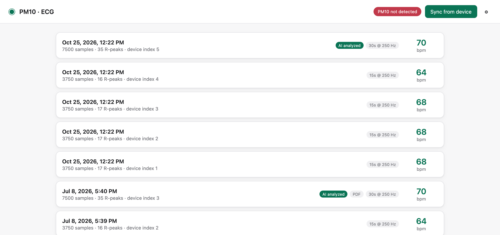
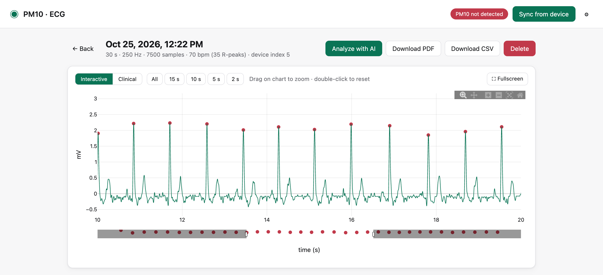
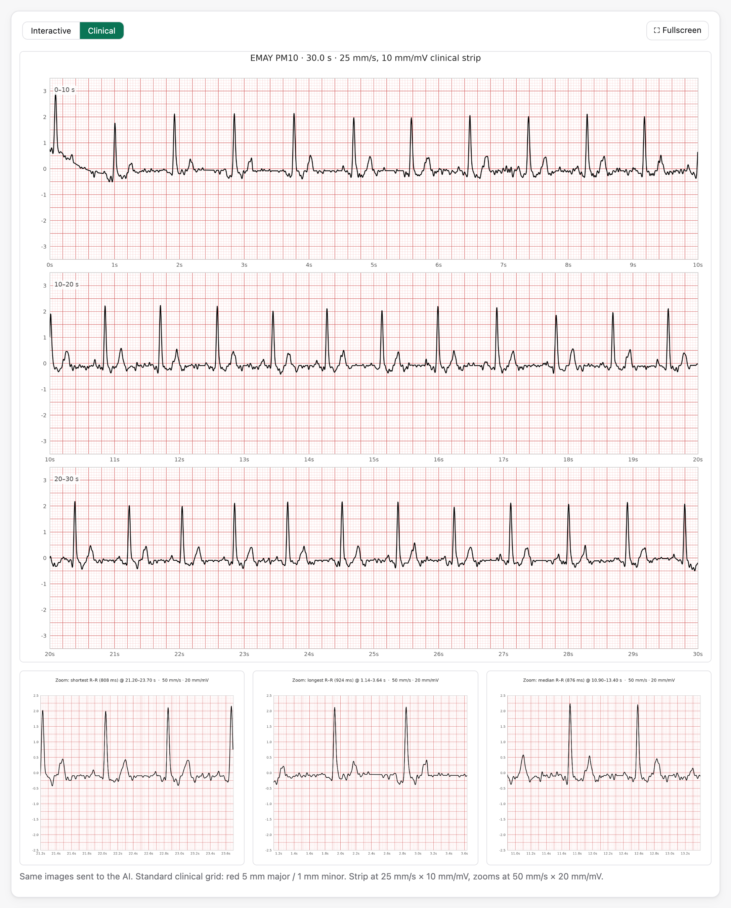
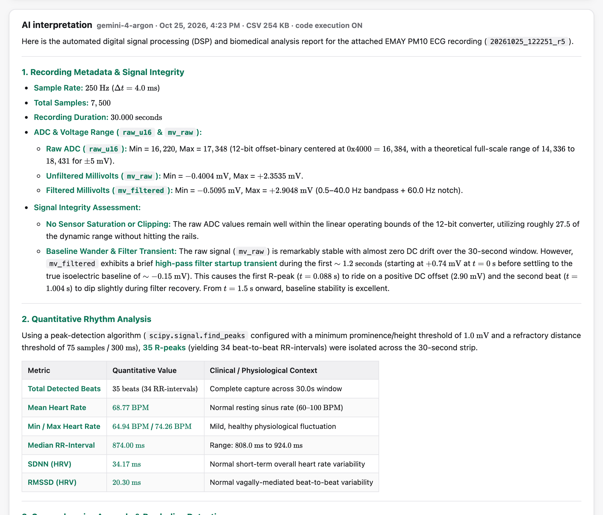

# emay-pm10

I have an EMAY PM10, a little handheld single-lead ECG monitor. It still works fine, but it's an older USB revision, and EMAY's current apps and Contec's PC software don't support it anymore. So it was basically a drawer gadget: it could record a trace, and I had no good way to get the data off or do anything with it.

At the same time, frontier AI models have gotten good at the exact thing I wanted: take raw time-series data, write and run their own signal-processing code, and explain what they find in plain language. That's what this project is about: **pairing legacy hardware with today's frontier models**. A device that's years old and no longer supported can still be useful when you connect it to a model that can reason about its output.

## What it does

- **Pulls recordings off the PM10 over USB.** I reverse-engineered the device's HID protocol, since nothing official works with this revision anymore.
- **Decodes and cleans the signal**, then shows it as an interactive chart or as a standard clinical strip on red ECG grid paper.
- **Sends the raw CSV to a frontier model** with code execution turned on. The model does its own peak detection, HRV metrics, anomaly checks and ensemble beat overlay, and writes up a verdict.
- **Exports** a PDF report or the raw CSV time series.

It all runs locally in a small Flask app. The only thing that leaves your machine is the CSV you choose to send for analysis.

## Screenshots

**Recordings synced from the device**



**Interactive view**: zoom, pan, R-peaks marked



**Clinical view**: 25 mm/s × 10 mm/mV strip, plus zoom tiles of the shortest, longest and median beat-to-beat intervals



**AI interpretation**: the model's own analysis of the raw data, rendered in the app



## One thing I didn't expect

Running the same capture through two different frontier models turned up a bug in my own decoder. One model blamed an ST-segment dip on filtering; the other checked the raw bytes and found the decoder was dropping a bit from every sample and one sample from every packet. That's also how I learned the device actually records at 250 Hz, not 240. Comparing models turned out to be a useful way to catch my own mistakes, not only to read ECGs.

## Quick start

```bash
git clone https://github.com/mlaslie/emay-pm10.git
cd emay-pm10
python3 -m venv .venv && source .venv/bin/activate
pip install -r requirements.txt
python webapp/app.py
```

Then open http://127.0.0.1:5555, plug in the PM10 with a USB **data** cable, and hit **Sync from device**. Add a Gemini API key in ⚙ Settings to turn on AI analysis.

Full setup, troubleshooting, the command-line tools and how the analysis works are in [docs/SETUP.md](docs/SETUP.md). The reverse-engineering notes are in [docs/](docs/).

## Disclaimer

This is a hobby project. It's not a medical device, it isn't FDA or CE cleared, and nothing it shows is a diagnosis. The AI output is one model's read of one consumer-grade trace. If something looks off, talk to an actual clinician.

## License

MIT. See [LICENSE](LICENSE).
